# 学籍云 · Web 前端界面

高校学生成绩管理系统的 Web 前端，配套本仓库的 C 语言控制台后端。

- 原生 **HTML / CSS / JavaScript**，零第三方依赖，双击 `index.html` 即可运行。
- 覆盖 C 后端菜单中的全部功能：添加、打印（列表）、删除、查找、修改、保存。
- 与 C 程序的 `data/student.txt` **二进制格式完全互通**：网页可以导入 C 生成的数据文件，也可以导出同名文件给 C 程序读取。
- 数据看板、成绩分析、深色主题、移动端响应式、键盘快捷键。
- 首次访问自动弹出 4 步新手引导；侧边栏「使用说明」页面可随时重新查看。
- 侧边栏支持**鼠标拖动调整宽度**：拖动右边缘伸缩，双击恢复默认，宽度自动记忆。

> **示例数据说明**：界面中的示例学生信息、截图以及自动化测试用例中使用的姓名、学号、成绩均为虚构，仅用于演示和测试，不对应任何真实个人；实际导入或手动录入的学生数据除外。

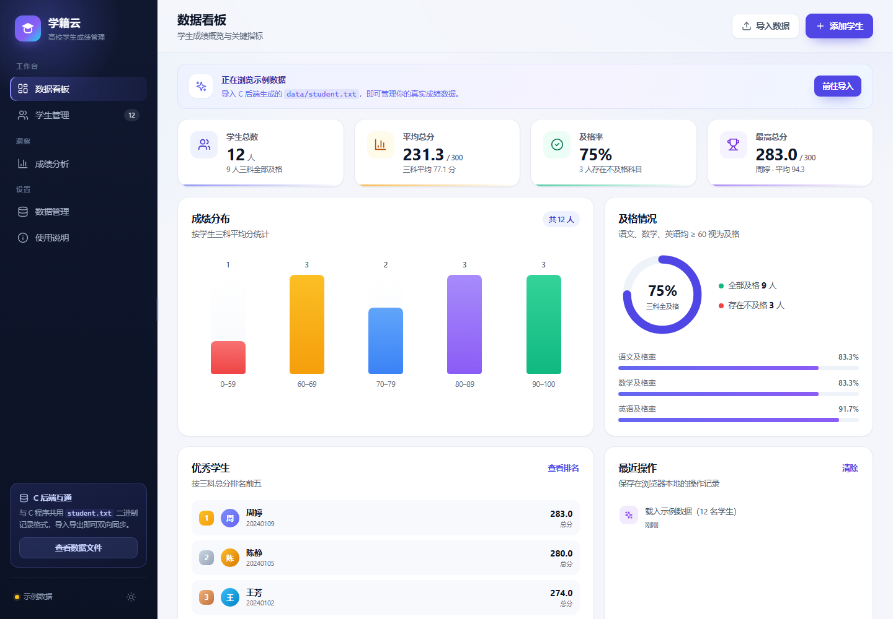

## 快速开始

直接双击打开 `web/index.html`（推荐 Chrome / Edge）。

> 不需要编译，不需要安装依赖，也不需要启动服务器。页面使用浏览器 `localStorage`
> 自动保存数据，刷新页面不会丢失。

如果需要通过本地 HTTP 访问（例如某些浏览器的本地策略较严格）：

```bash
# 在项目根目录执行（需要本机有 Python）
python -m http.server 8000 --directory web
# 然后访问 http://localhost:8000
```

## 第一次使用

首次打开页面时，会自动弹出 4 步新手引导：

1. 认识界面与示例数据；
2. 了解数据导入、管理和备份方式；
3. 掌握录入、管理与导出三步流程；
4. 选择起点：导入学生数据文件、先浏览当前数据，或查看完整说明。

完成或关闭引导后不会再自动弹出；随时可以点击侧边栏「使用说明」重新查看，
或在该页面点击「重新观看引导」。

| 首次使用引导 | 使用说明页面 |
| :---: | :---: |
| 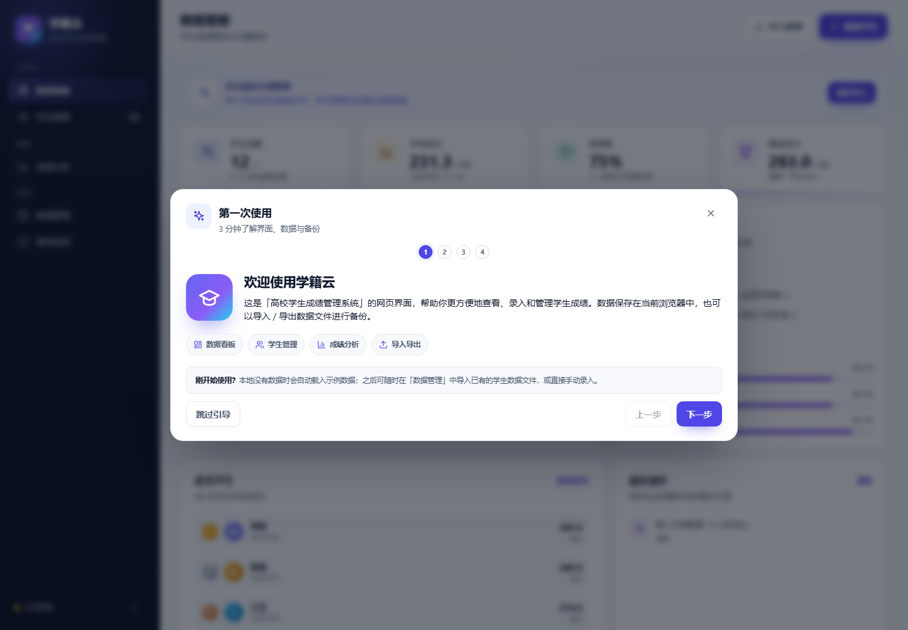 | 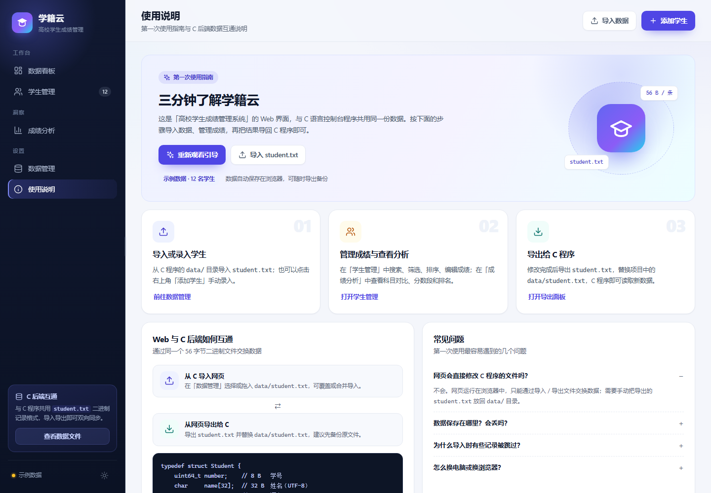 |

## 功能对照

| C 控制台菜单 | Web 界面 |
| :--- | :--- |
| 1. 添加学生信息 | 右上角「添加学生」或学生管理页按钮，表单录入并校验 |
| 2. 打印学生信息 | 「学生管理」表格；支持搜索、筛选、排序、分页 |
| 3. 删除学生信息 | 表格行内删除；删除后提示条可撤销 |
| 4. 查找学生信息 | 顶部搜索框（学号 / 姓名），或按及格情况筛选 |
| 5. 修改学生信息 | 表格行内编辑，可改学号、姓名与三科成绩 |
| 6. 保存学生信息 | 每次修改自动写入 `localStorage`；可导出 `student.txt` / JSON / CSV |
| 0. 退出系统 | 关闭页面即可，数据已自动保存 |
| —— | 额外提供：新手引导、使用说明、数据看板、成绩分析、深色主题、示例数据 |

## 与 C 程序共用数据

Web 界面与 C 程序通过同一个二进制文件格式交换数据，互不影响对方的代码。

### 从 C 导入到网页

1. 备份 C 程序的 `data/student.txt`（避免误操作）。
2. 打开网页，进入「数据管理」。
3. 在「学生数据文件」卡片中选择文件，或直接拖入 `data/student.txt`。
4. 选择「覆盖当前数据」或「合并导入」，确认即可。

### 从网页导出给 C

1. 进入「数据管理」，点击「导出 student.txt」。
2. 用下载得到的 `student.txt` 替换项目中的 `data/student.txt`（建议先备份原文件）。
3. 在项目根目录运行 C 程序：

```bash
./StudentManageSystem.exe
# 或
./build/Debug/outDebug.exe
```

> C 程序使用相对路径 `./data/student.txt`，请务必在项目根目录运行；
> 导出的文件与 C 程序当前使用的 56 字节固定布局一致，可直接替换 `data/student.txt`。

## 二进制格式

前端完全按照 C 结构体的内存布局读写，字段采用小端序（x86-64 / MinGW-w64 GCC）：

| 偏移 | 长度 | 字段 | 说明 |
| :---: | :---: | :--- | :--- |
| 0 | 8 | `uint64_t number` | 学号，小端序；前端按 BigInt 处理，支持完整 uint64 范围 |
| 8 | 32 | `char name[32]` | 姓名，UTF-8 编码，NUL 填充；前端限制最多 31 字节 |
| 40 | 4 | `float chinese` | 语文成绩，小端序 |
| 44 | 4 | `float math` | 数学成绩，小端序 |
| 48 | 4 | `float english` | 英语成绩，小端序 |
| 52 | 4 | 对齐填充 | 前端导出时写 0 |
| **合计** | **56** | 固定布局 | 每条记录 56 字节 |

导入时会校验：

- 文件长度必须是 56 的整数倍；
- 学号必须在 `uint64` 范围内，重复学号会被跳过并提示；
- 姓名必须非空且不超过 31 个 UTF-8 字节（保证 C 结构体有结尾 `\0`）；
- 三科成绩必须是 0–100 的有限浮点数。

成绩显示与 C 程序一致，保留一位小数（对应 `printf("%.1f")`）。

## 项目结构

```
web/
├── index.html                 单页界面（四个视图 + SVG 图标系统）
├── css/
│   └── style.css              设计系统、响应式、深色主题
├── js/
│   ├── core.js                纯数据逻辑：校验、二进制编解码、统计、存储（可被 Node 测试）
│   └── app.js                 界面逻辑：渲染、表单、导入导出、弹窗、Toast
├── screenshots/               界面截图（由端到端测试生成）
├── tests/
│   ├── core.test.mjs          core.js 单元测试（23 项）
│   └── browser-smoke.mjs      Edge headless 端到端测试（66 项，生成截图）
└── README.md
```

## 数据存储

| `localStorage` 键 | 内容 |
| :--- | :--- |
| `sms.students.v1` | 学生记录、示例数据标记、上次保存时间 |
| `sms.activity.v1` | 最近 30 条操作记录 |
| `sms.theme.v1` | 浅色 / 深色主题偏好 |
| `sms.onboarded.v1` | 是否已完成首次使用引导 |
| `sms.sidebar.width.v1` | 侧边栏宽度（拖拽后自动记忆） |

数据默认保存在当前浏览器中。清除浏览器站点数据会同时清除学生记录，
请定期通过「数据管理」导出 `student.txt` 或 JSON 备份。

## 测试

### 数据逻辑单元测试

```bash
node --test web/tests/core.test.mjs
```

覆盖：字段校验、uint64 边界、UTF-8 字节限制、二进制编解码、真实 `data/student.txt`
解析、统计、排序筛选、JSON/CSV、`StudentStore` 持久化、撤销重复学号保护、
BOM JSON、CSV 公式注入、非法 UTF-8 姓名与活动记录清洗等。

### 浏览器端到端测试

```bash
node web/tests/browser-smoke.mjs
```

要求：

- Windows + 已安装 Microsoft Edge（可用 `EDGE_PATH` 环境变量指定路径）；
- Node.js 22+（使用内置 `WebSocket`）。

测试会启动 headless Edge，逐项验证首次使用引导、使用说明页面、侧边栏拖动伸缩、页面加载、增删改查、搜索排序分页、
二进制导入导出（含导出文件字节校验）、深色主题、移动端布局、焦点管理与
`file://` 打开，并重新生成 `screenshots/`；运行期间若出现任何 JavaScript 错误会判定失败。

> 注意：测试会重写 `web/screenshots/` 下的截图，并临时启动一个本地静态服务器
> 与 headless Edge。默认端口为 8137 / 9333，可通过 `SMS_TEST_HTTP_PORT` 和
> `SMS_TEST_DEBUG_PORT` 环境变量覆盖。

## 截图

| 首次使用引导 | 选择起点 |
| :---: | :---: |
|  | 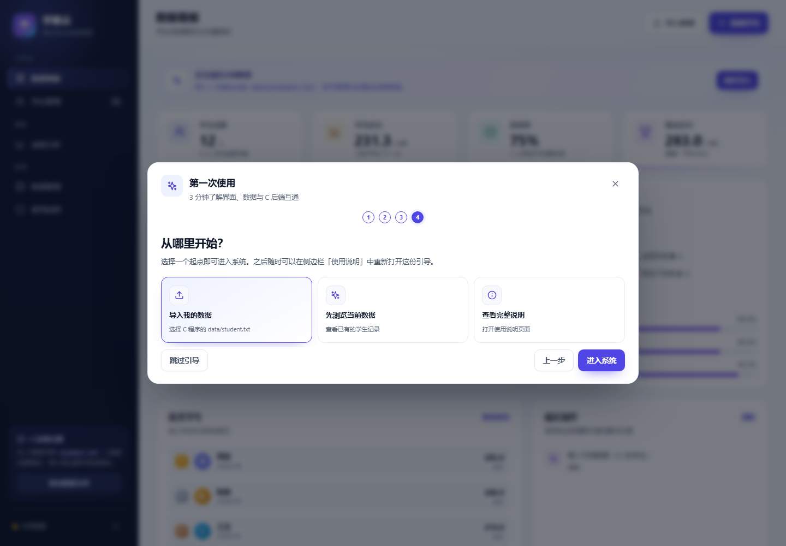 |

| 数据看板 | 学生管理 |
| :---: | :---: |
|  | 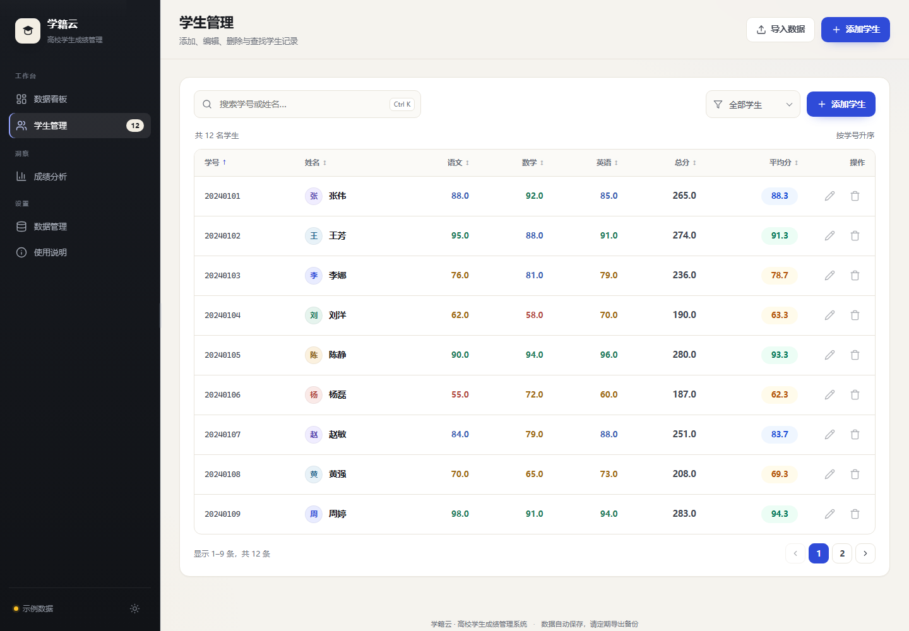 |

| 添加学生 | 成绩分析 |
| :---: | :---: |
| 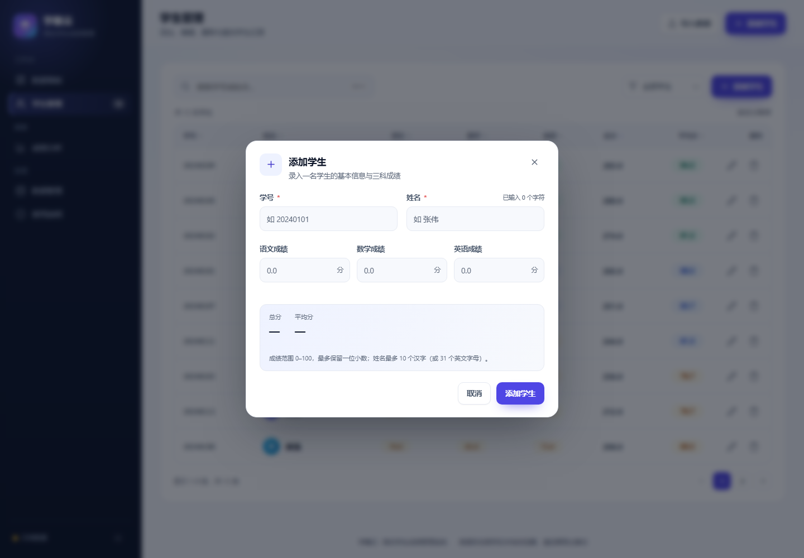 | 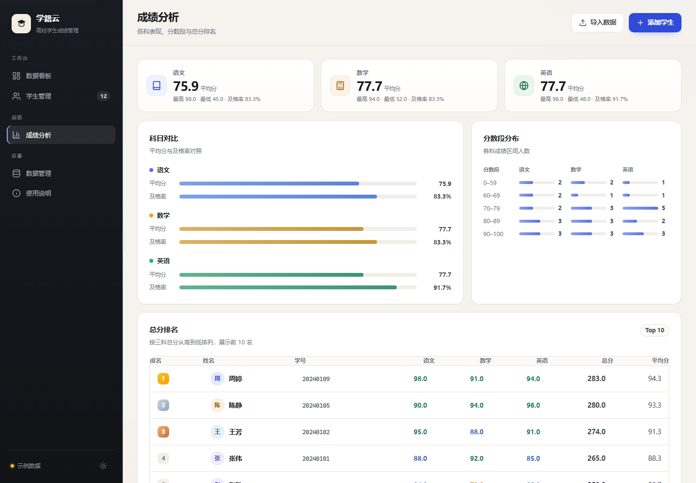 |

| 数据管理 | 深色主题 |
| :---: | :---: |
| 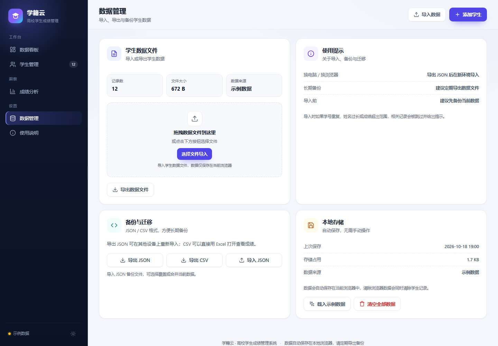 | 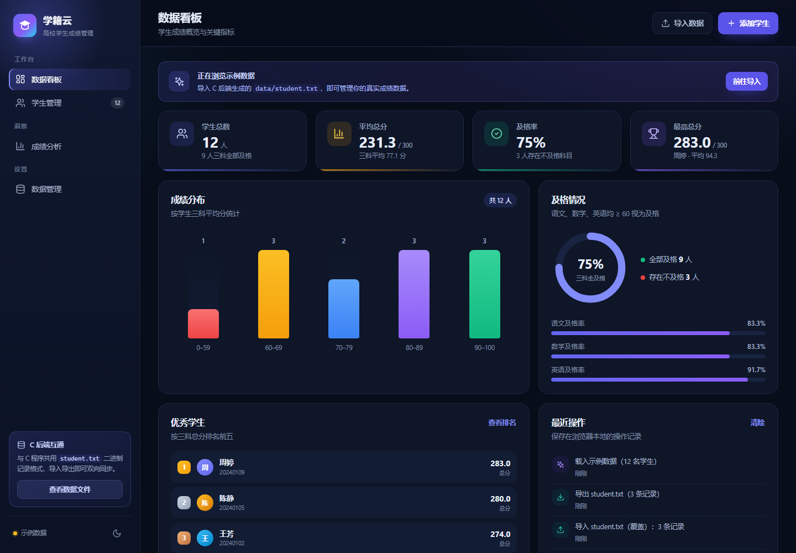 |

| 使用说明 | 移动端看板 |
| :---: | :---: |
|  | 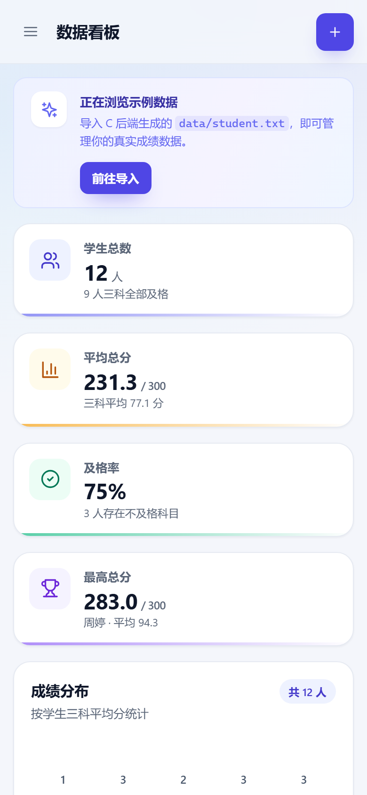 |

| 移动端学生管理 | 移动端使用说明 |
| :---: | :---: |
| 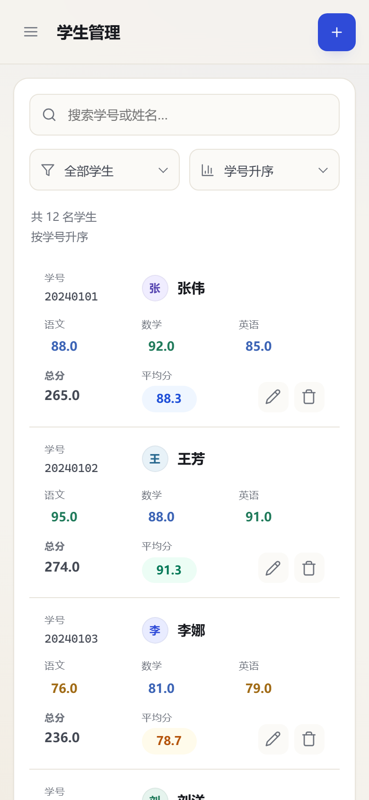 | 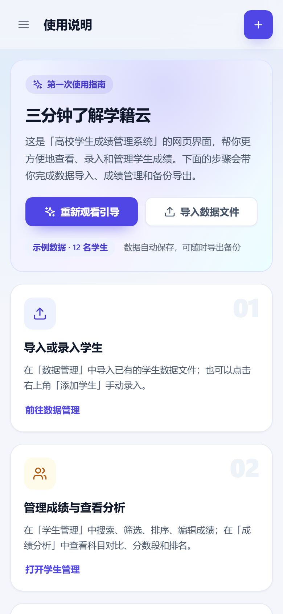 |

| 侧边栏拖动伸缩 | 导入数据 |
| :---: | :---: |
| 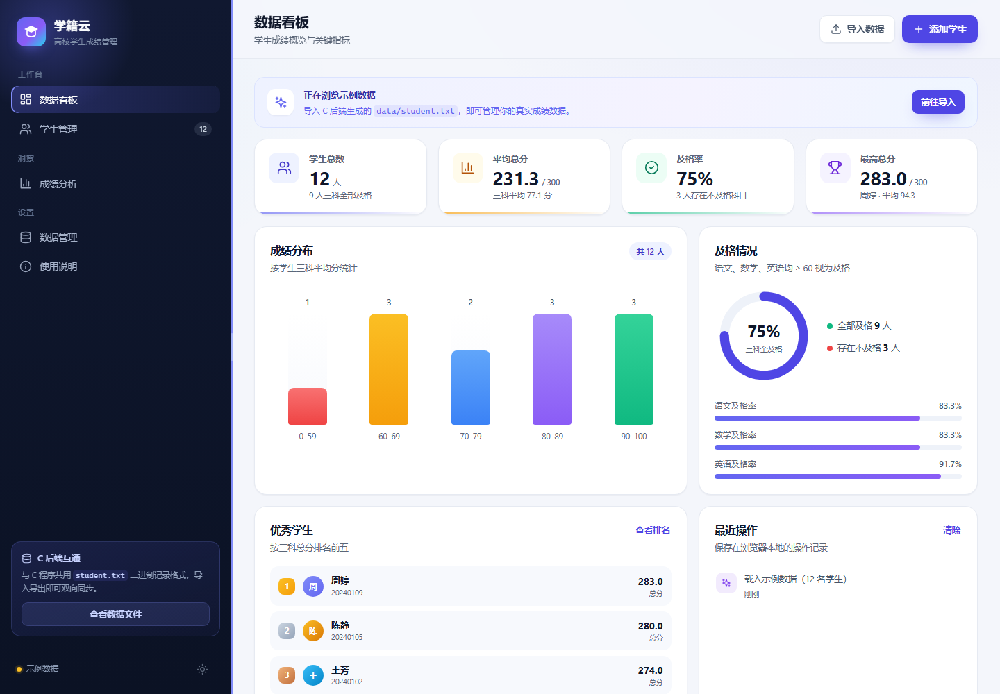 | 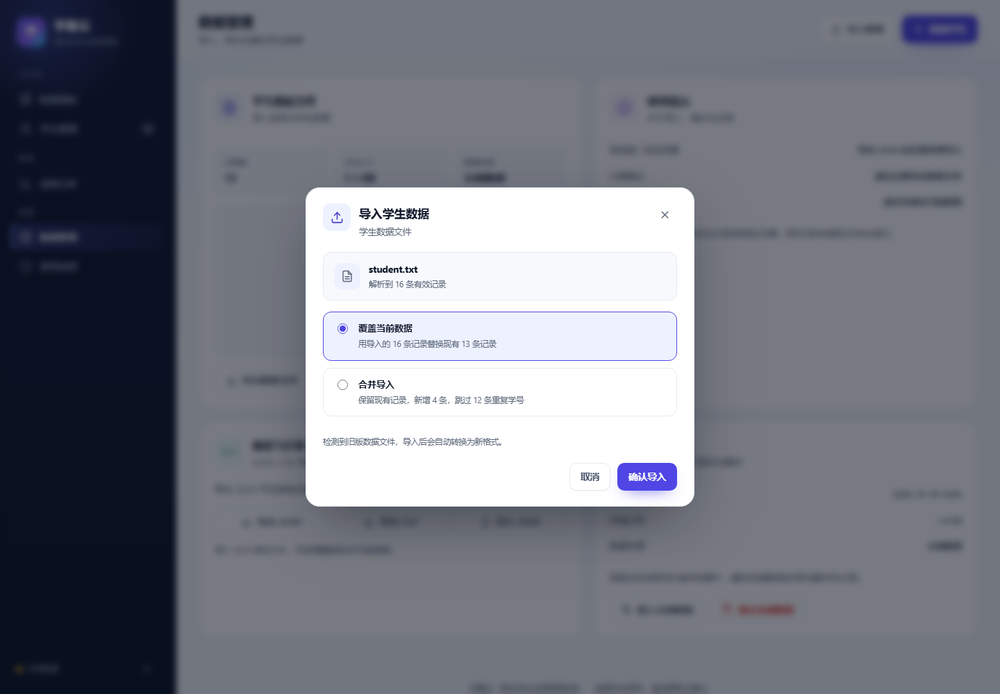 |

## 设计说明

- **配色**：靛蓝主色 + 深色导航栏，成绩用绿 / 蓝 / 琥珀 / 红四档语义色；
- **布局**：桌面端侧边栏 + 卡片栅格；侧边栏右边缘可拖动伸缩（208–360px），
  `≤980px` 侧边栏收起为抽屉；`≤760px` 学生表格自动切换为卡片布局，并提供排序下拉框；
- **主题**：通过 CSS 变量实现浅色 / 深色主题，偏好保存在 `localStorage`；
- **无障碍**：语义化标题与表格、`aria-label`、`aria-sort`、焦点环、
  `Esc` 关闭弹窗、`Ctrl / Cmd + K` 聚焦搜索框；
- **图表**：纯 CSS / 内联 SVG 绘制，无外部 CDN，完全离线可用。

## 已知限制

- 网页与 C 程序之间是**文件交换**，不是实时同步；修改后需要重新导入 / 导出。
- 数据存在浏览器 `localStorage`，换浏览器或清除站点数据后需要重新导入备份。
- 导入 C 文件时会跳过成绩不在 0–100、学号重复或姓名不是合法 UTF-8 的记录；
  被跳过的记录不会进入网页，若再覆盖导出，它们将不再存在于文件中，导入前请先备份。
- 「撤销删除」只保留最近一次删除，刷新页面后失效；如果学号已被重新添加，撤销会被拒绝。
- 示例数据仅在首次打开且本地无数据时自动载入；清空后可手动点击「载入示例数据」。
- 二进制格式采用固定 56 字节布局（小端序）；C 端已逐字段读写，不再依赖结构体填充字节，
  但跨大端平台使用旧数据文件仍需做字节序转换。

## 与 C 后端实时联调（可选扩展）

当前实现零改动 C 代码，通过文件格式互通。若后续希望网页实时读写同一份数据，
可以在 C 侧增加一个轻量 HTTP 服务层（如 Winsock + 现有 `ForwardList` / `Student` 模块）
暴露 JSON API，前端再把 `StudentStore` 替换为 API 适配器即可；现有 UI、统计和交互逻辑无需改动。

---

返回项目根目录：[README.md](../README.md)
